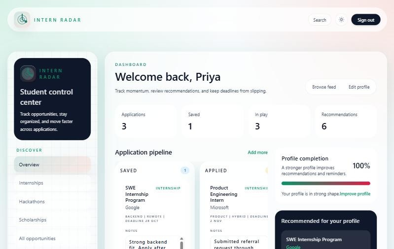
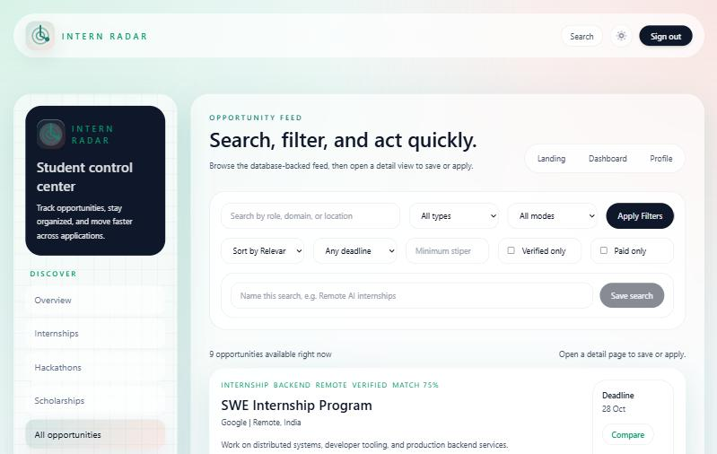
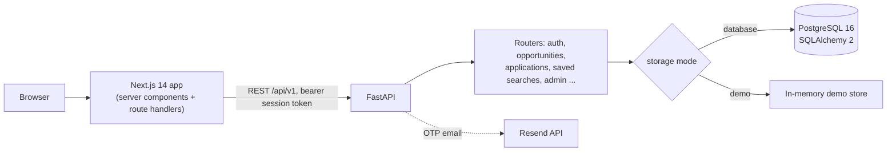

# Intern Tracker


A student opportunity discovery platform for internships, hackathons, coding contests, scholarships, workshops and tech events.



| Opportunity feed | |
|---|---|
|  | Search by role, company, domain or location; filter by type, mode, deadline, stipend and verification; save searches; compare opportunities side by side. |

Screenshots are from the app running locally in demo mode (no database).

## Features

- **Opportunity discovery**: search, filter, sort and compare opportunities, with recommendations based on the student profile
- **Application tracking**: track application status from a dashboard
- **Passwordless login**: email one-time codes (hashed at rest, expiring) sent through the Resend API, with session tokens
- **Security**: per-identifier rate limiting on OTP requests, audit logging of auth events, security headers, trusted-host and CORS middleware
- **Admin tools**: token-protected admin routes for managing opportunities and reviewing user feedback
- **Extras**: saved searches, notifications, community and feedback endpoints, plus resume-analysis and cover-letter helpers
- **Demo mode**: the API runs on an in-memory store with no database (`INTERN_TRACKER_DEMO_MODE=demo`)

## Stack

| Layer | Technology |
|---|---|
| Frontend | Next.js 14, React 18, TypeScript, Tailwind CSS |
| Backend | FastAPI, SQLAlchemy 2, Pydantic 2 |
| Database | PostgreSQL 16 |
| Infrastructure | Docker Compose, GitHub Actions CI (Ruff, pytest, frontend build), Render config |

## Architecture (as built)



The same routers serve both storage modes, and the backend test suite runs against the demo store so it needs no database.
`docs/system-architecture.md` describes the longer-term design (ingestion, caching, push notifications), much of which is not built yet.

## Try the API

```bash
cd apps/api && pip install -r requirements.txt
INTERN_TRACKER_DEMO_MODE=demo uvicorn app.main:app --port 8000
```

```bash
$ curl "localhost:8000/api/v1/opportunities?search=google&limit=1"
{
  "items": [
    {
      "slug": "google-swe-internship-program",
      "title": "SWE Internship Program",
      "organization": "Google",
      "type": "internship",
      "mode": "Remote",
      "location_text": "Remote, India",
      "is_verified": true,
      ...
    }
  ],
  "metadata": {"total": 1, "page": 1, "page_size": 1, "has_next_page": false}
}

$ curl -X POST localhost:8000/api/v1/auth/request-otp -H "Content-Type: application/json" -d '{"email": "you@college.edu"}'
{"challenge_id": "...", "message": "Demo OTP generated. Use 000000 to continue.", "channel": "email", "target_hint": "yo*@college.edu", "development_code": "000000"}

$ curl localhost:8000/api/v1/applications -H "Authorization: Bearer demo-student-token"
{"items": [ ...three seeded applications with status, notes and follow-up dates... ]}
```

Interactive docs: `http://localhost:8000/api/v1/docs`.

## Tests

```bash
cd apps/api
pip install -r requirements-dev.txt
pytest -q
```

CI runs Ruff, the API test suite and a production build of the web app on every push.

## Repository layout

```text
apps/
  api/        FastAPI backend (routers, models, schemas, services, rate limiter, audit log)
  web/        Next.js frontend (dashboard, opportunities, compare, profile, admin, feedback, help)
docs/         Architecture, database schema, API spec, wireframes, roadmap, threat model
infra/        Docker Compose and Postgres init script
```

## Run locally

```bash
# database
docker compose -f infra/docker-compose.yml up -d postgres

# API (http://localhost:8000/docs)
cd apps/api
pip install -r requirements.txt
uvicorn app.main:app --reload

# or without a database
INTERN_TRACKER_DEMO_MODE=demo uvicorn app.main:app --reload

# web app (http://localhost:3000)
cd apps/web
npm install
npm run dev
```

API routes are served under `/api/v1`. Configuration uses `INTERN_TRACKER_*` environment variables (see `apps/api/app/config.py`).

## Documentation

- [System Architecture](docs/system-architecture.md)
- [Database Schema](docs/database-schema.md)
- [API Endpoints Specification](docs/api-endpoints.md)
- [UI Wireframes & Component Specs](docs/ui-wireframes.md)
- [Development Roadmap](docs/development-plan.md)
- [Security & Threat Model](docs/SECURITY.md)

## License

[MIT](LICENSE)
